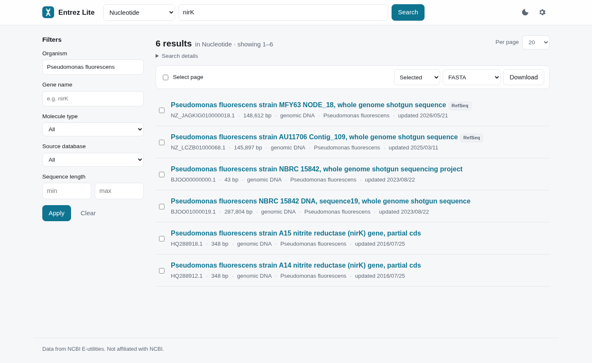
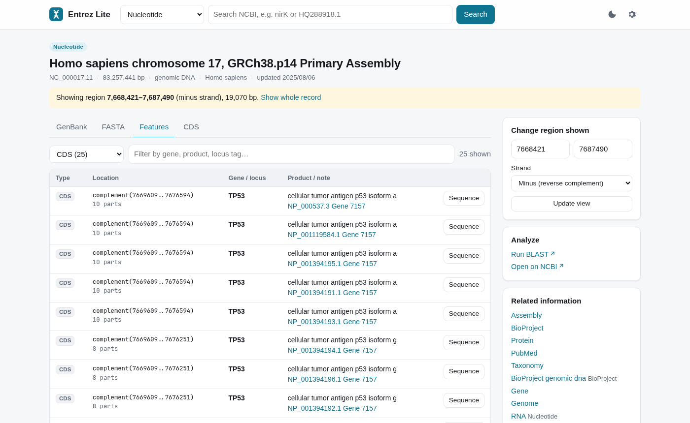
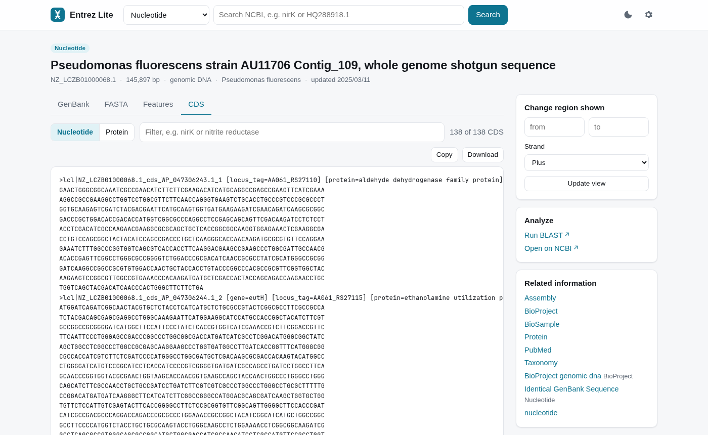
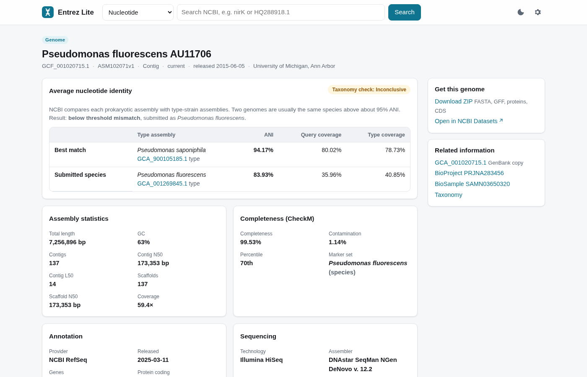

<div align="center">


# Entrez Lite

**NCBI search that still works when NCBI's website doesn't.**

[](https://kowalskibio.github.io/entrez-lite/)

[](js)
[](#run-it)
[](https://www.ncbi.nlm.nih.gov/books/NBK25501/)
[](LICENSE)

[**What it does**](#what-it-does) · [**Run it**](#run-it) · [**Recipes**](#recipes) · [**How it works**](#how-it-works) · [**Limits**](#limits)

<br />

<picture>
  <source media="(prefers-color-scheme: dark)" srcset="docs/images/search-dark.png" />
  
</picture>

</div>

<br />

You search NCBI for a gene, and half the result counts say `error`. You open a GenBank record and the page is empty except for the sidebar. You hit a 500 three times in a row. NCBI's API is usually fine while this happens, so Entrez Lite talks only to the API.

It's three files and a stylesheet. Open `index.html` and search.

## What it does

<table>
  <tr>
    <td width="33%" valign="top">
      <h3>Search like NCBI</h3>
      Nucleotide, Protein, Gene, PubMed, PMC, Taxonomy, Assembly, BioProject, BioSample, SRA, Structure and more. Full Entrez syntax works, plus a filter sidebar for organism, gene name, molecule type, RefSeq vs. GenBank and sequence length. Results come sorted by relevance, like on NCBI. Type a species name as plain text and you get a one-click link to that organism only.
    </td>
    <td width="33%" valign="top">
      <h3>Get the gene out</h3>
      A hit is often a 150 kb contig with your gene somewhere inside it. The <b>CDS</b> tab lists every coding sequence in the record and filters as you type, so <code>nirK</code> gives you one FASTA entry.
    </td>
    <td width="33%" valign="top">
      <h3>Exons included</h3>
      Click <b>Sequence</b> on any row of the feature table. Each interval is fetched on the right strand and joined in transcript order. Tested on human TP53: the 10-exon CDS translates to NP_000537.3 residue for residue.
    </td>
  </tr>
  <tr>
    <td valign="top">
      <h3>Any region, either strand</h3>
      Set a range under <b>Change region shown</b> and the GenBank, FASTA, feature and CDS views all follow it. A Gene record links its genomic location straight to that region of the chromosome.
    </td>
    <td valign="top">
      <h3>Follow the links</h3>
      <b>Related information</b> uses ELink, the same link data NCBI's own sidebar uses. Jump from a contig to its proteins, assembly, BioSample or papers, and from a gene to its RefSeq transcripts.
    </td>
    <td valign="top">
      <h3>Take it with you</h3>
      Download selected records, the current page or up to 500 results as FASTA, GenBank, an accession list or CSV. Every view has its own URL, so you can bookmark it or send it to someone.
    </td>
  </tr>
</table>

<p align="center">
  
  
</p>

### Is it really the species it says?

Every contig and assembly record gets a **Genome** card in the sidebar. It finds the assembly the sequence belongs to (`GCF_` if there is a RefSeq copy, `GCA_` otherwise) and shows NCBI's ANI taxonomy check right there. **Genome & ANI** opens the full genome page:

- **ANI** against the best type-strain match and against the type strain of the submitted species, with ANI and coverage for both
- **CheckM** completeness and contamination
- **Assembly statistics:** length, GC, contigs, N50, L50, coverage
- **Annotation** gene counts and the **sequencing** details
- **Every sequence** in the assembly, each linked to its record
- **A ZIP download** with genome FASTA, GFF, proteins and CDS

You can also paste a `GCF_` or `GCA_` accession into the search box, or pick **Genome** in the database menu and search by organism. Genome search lists every assembly for a taxon with its level, size, contig count, CheckM score and ANI check, and filters by RefSeq or GenBank, assembly level, reference genomes, type strains and atypical assemblies. Partial names get suggestions as you type. Tick some rows to download an accession list, a CSV or a ZIP of the genomes. Each type-strain match links to that genome's page, so you can follow a misassigned strain to the species it actually matches.

<p align="center">
  
</p>

## Run it

**Online:** [kowalskibio.github.io/entrez-lite](https://kowalskibio.github.io/entrez-lite/)

**Locally:** clone the repo and open `index.html`. Your browser is the only requirement.

```bash
git clone https://github.com/KowalskiBio/entrez-lite.git
xdg-open entrez-lite/index.html     # macOS: open, Windows: start
```

NCBI allows 3 requests per second without an API key. Paste a free key into **Settings** (the gear icon) to get 10. You can make one under [NCBI account settings](https://account.ncbi.nlm.nih.gov/settings/). The key stays in your browser's local storage and is only ever sent to NCBI.

## Recipes

| You want | Do this |
|---|---|
| One gene from a bacterial genome | Open the genome or contig, go to **CDS**, type the gene name, then **Download** |
| The same gene from many strains | Search Protein for `nirK[Gene Name] AND "Pseudomonas"[Organism]`, choose **All results** (up to 500) and **FASTA** |
| A human gene with its introns | Search Gene, open the record, click the genomic location link |
| Just the mature CDS of that gene | From the same region, go to **Features**, pick the CDS row, click **Sequence** |
| A record you already know | Paste the accession (`HQ288918.1`) into the search box |
| Complete genomes of a species | Pick **Genome**, search `Pseudomonas fluorescens`, tick **Complete genome** |
| To check a strain's species | Open any of its contigs and look at the **Genome** card, or paste the `GCF_` accession |
| To see what NCBI did with your query | Open **Search details** above the results |

## How it works

```
index.html        page shell
css/styles.css    light and dark theme, one set of tokens
js/eutils.js      E-utilities and Datasets clients: throttling, retries, parsers
js/app.js         hash router and all the views
```

Everything goes through [E-utilities](https://www.ncbi.nlm.nih.gov/books/NBK25501/): `esearch` for hits, `esummary` for the result list, `efetch` for GenBank, FASTA, feature tables and CDS, and `elink` for related records. Genome pages come from the [Datasets v2 API](https://www.ncbi.nlm.nih.gov/datasets/docs/v2/api/), which provides the assembly report, CheckM, ANI and the sequence list. Both services allow cross-origin requests, so the browser calls them directly and no proxy is needed.

A few details that took some testing:

- **Rate limits.** Requests go through a queue spaced at 350 ms, or 110 ms with an API key. On a `429` or `5xx` the client waits and retries up to three times.
- **Bot checks.** When NCBI answers with an HTML challenge page instead of data, you get an error that says so, not a JSON parse error.
- **Region feature tables.** When you fetch a feature table for a sub-range, NCBI numbers it from the start of that range. The parser shifts the coordinates back to positions on the full sequence.
- **Locus tags.** In RefSeq tables, the gene name and locus tag sit only on the `gene` feature. They're copied onto the CDS and RNA features that span the same coordinates, so every row has a name.
- **Long ID lists.** These go as form-encoded POSTs, which still count as simple CORS requests and skip the preflight.

## Limits

- **BLAST.** **Run BLAST** and **Open on NCBI** go to the NCBI website, so they break when it does.
- **No Graphics view.** There's no graphical sequence viewer like NCBI's.
- **10,000 results.** Paging stops there because the API stops there. Narrow the query to see more.
- **Large records.** Anything over 1 Mb asks before loading in full. Over 20 Mb, set a region first.

## License

[AGPL-3.0](LICENSE). Not affiliated with NCBI. The data comes from NCBI's public E-utilities service, which has its own [usage guidelines](https://www.ncbi.nlm.nih.gov/books/NBK25497/).
